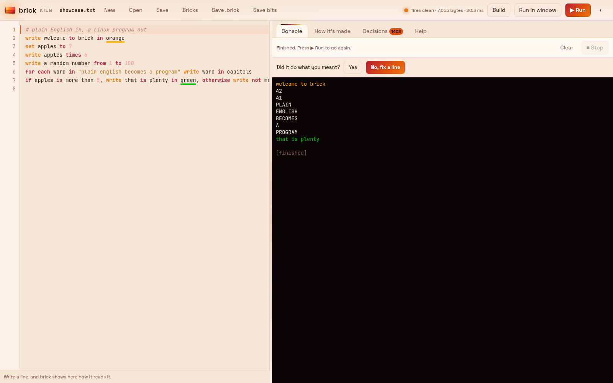
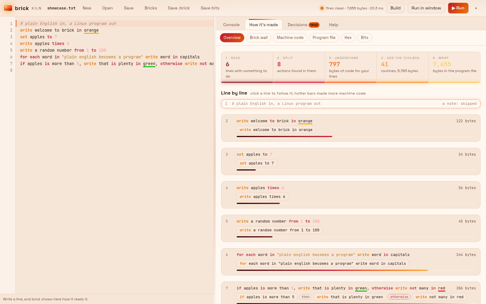
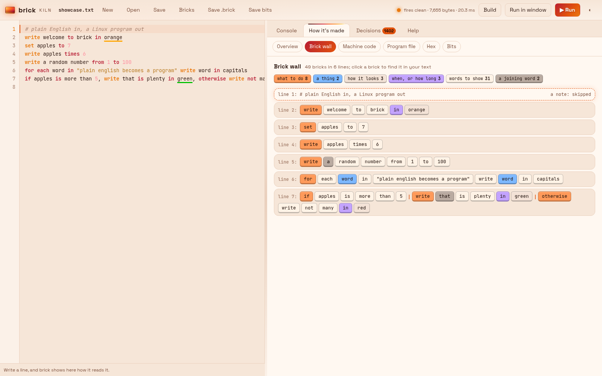
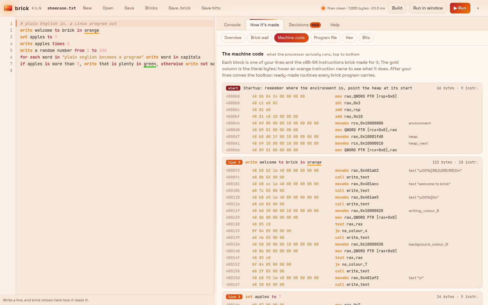
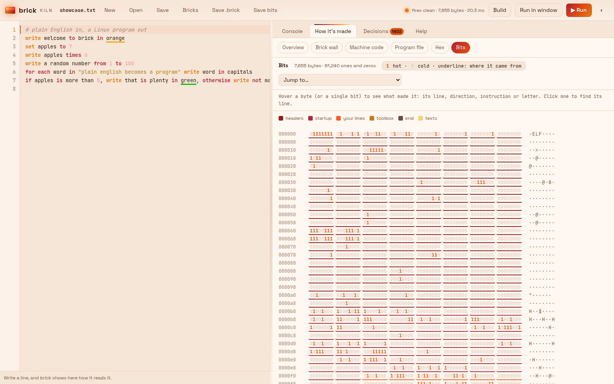
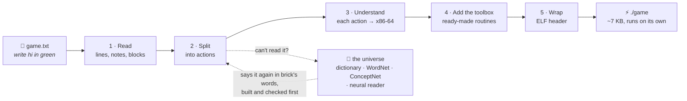

<p align="center">
  
</p>

<p align="center">
  
  
  
  
</p>

<p align="center">
  <b>You write what you want in everyday English.<br>
  brick fires it, like clay in a kiln, into a real Linux program:<br>
  a few kilobytes of x86-64 machine code that the processor runs directly.</b>
</p>

<p align="center">
  <a href="#-quick-start">Quick start</a> ·
  <a href="#-a-tour-of-the-language">The language</a> ·
  <a href="#-brick-kiln-the-window">brick kiln</a> ·
  <a href="#-how-it-works">How it works</a> ·
  <a href="#-brick-teaches-itself">Learning</a> ·
  <a href="#-every-command">Commands</a>
</p>

---

## ✨ In thirty seconds

Write this in a text file called `game.txt`:

```text
write get ready, wait a random number from 1 to 5 seconds, write GO in green,
start a timer as t, wait for a key, write you took t seconds
```

Then run:

```console
$ brick game.txt
```

brick builds `./game` (a stand-alone program of about 7 KB) and runs it.
You have just written a reaction-time game in one sentence.

There is no Python inside `./game`, no C compiler was used, and no C library is linked in.
brick wrote every byte of it: the machine code, the data and the ELF header that Linux needs.

```console
$ file game
game: ELF 64-bit LSB executable, x86-64, version 1 (SYSV), statically linked, no section header
```

<p align="center">
  
  <br><sub>brick kiln, the window: the English on the left, the finished program running on the right.</sub>
</p>

---

## 🧱 What brick is

brick is a compiler for loose, everyday English.
It is written in plain Python (standard library only) and it makes real native programs for 64-bit Linux.

It is built around three ideas:

| Idea | What it means for you |
|---|---|
| **Say it how you'd say it** | `write hello in green`, `ask your name`, `wait 2 seconds`, `for each name in names write hello name`. No brackets, no semicolons, no keywords to learn first. |
| **Forgive the mess** | `ok so TOP of screen hello there in red;bg blue   then 2 secs wait lol` still builds. brick reads typos, short forms, chatter and wrong punctuation, then tells you how it read them. |
| **Show the work** | Every line can be followed all the way down: from your words, to the actions brick found, to the machine code, to the bytes, to the individual 1s and 0s in the file. |

---

## 🚀 Quick start

**You need:**

- Linux on a 64-bit Intel or AMD processor (x86-64).
- Python 3. Nothing to install with pip. (Tested on Python 3.14.)
- A web browser, only if you want the window (`brick gui`).

**Get it and try an example:**

```console
$ git clone https://github.com/tuniveza/brick.git
$ cd brick
$ python3 brick.py texts/examples/hello.txt
```

**Optional: make `brick` a command you can type anywhere.**
Put this small script in a folder on your `PATH` (for example `~/.local/bin/brick`) and make it runnable with `chmod +x`:

```sh
#!/bin/sh
exec python3 /path/to/brick/brick.py "$@"
```

**Open the window:**

```console
$ brick gui                  # opens brick kiln in your browser
$ brick gui game.txt         # opens it with game.txt loaded
```

> [!TIP]
> Not sure what to type? `brick help` lists every phrase brick understands, with examples.
> `brick help dictionary` lists the 765 everyday words it also knows.

---

## 📖 A tour of the language

Each line is one or more directions.
Join directions with commas, full stops, `then` or `and`.
Lines starting with `#` are notes for people and are skipped.

### Showing things

```text
write hello there in green
write "Score:" score in bold red
write GAME OVER in big red letters
write hi on the same line
write a blank line
write the numbers from 1 to 10
```

Colours: black, blue, brown, cyan, gold, grey, green, lime, magenta, orange, pink, purple, red, white, yellow.
You can also say `in light blue`, `on a blue background` or `in bold red`.
The dictionary adds hundreds more, such as `crimson`, `navy` and `teal`.

### Numbers and words

```text
set x to 7
write x plus 3                          → 10
write x divided by 2                    → 3.50
write three point five plus 1 to 3 places   → 4.500
write round 2.6                         → 3
write a random number from 1 to 100
write length of name plus 1
write first letter of secret in capitals
write join secret with "!"
```

Whole numbers, decimals, words, yes/no, timers and lists are all understood.
A divide is shown whole when it divides evenly, and to 2 places when it doesn't.

### Asking

```text
ask "What is your name?" as name
ask a number as guess
ask your age
```

### Choices and repeats

```text
if score is more than 10, write well done in green, otherwise write keep going
repeat 3 times: write hello
take 1 from lives until lives is 0
for each letter in secret if letter is guess write letter on the same line otherwise write _ on the same line
```

Checks: `is`, `is not`, `is more than`, `is less than`, `is at least`, `contains`, `is in`, `starts with`.
A line ending in `:` (repeat, if, for each, otherwise) takes the indented lines under it as its block.

### Lists

```text
make a list called names, ask a name 3 times and add it to names, then for each name in names write hello name
write there are how many in names people
put "Zed" at the front of names
write item 2 of names
remove the last from names
```

### Files: things that survive closing the program

```text
load best.txt as best
ask "What did you score?" as score
if score is more than best, write "New high score!" in green and save score to best.txt
add score to the end of scores.txt
```

### Time

```text
wait 2 seconds
wait 500 milliseconds
after 5 seconds write hi
start a timer as t
wait for a key
write you took t seconds
```

### The screen and the window

```text
clear the screen
write GO in the middle of the screen
write score at row 2 column 10
set the title to My Game
put the window on the left side of the screen
make the window full screen
make the window 800 by 600
centre the window
```

Placing text works in any Linux terminal.
Moving the window itself works on the [Hyprland](https://hyprland.org) desktop.
Elsewhere, window directions are skipped safely and the rest of the program still runs.

### Teaching brick your own words

```text
to greet someone means write hi someone in green
to double a number means write number times 2
greet Dominic                           → hi Dominic (in green)
double 21                               → 42
```

The words `someone`, `somebody`, `something`, `a number` and `a word` become gaps that are filled in each time.
Your words are saved in `mywords.txt`, so they are still there next time.

### Complete examples

The folder [`texts/examples`](texts/examples) has finished programs to read and run:

| File | What it shows |
|---|---|
| [`hello.txt`](texts/examples/hello.txt) | Colours, numbers, decimals, the time |
| [`reaction.txt`](texts/examples/reaction.txt) | A reaction-time game in one line |
| [`names.txt`](texts/examples/names.txt) | Lists: adding, counting, picking items |
| [`highscore.txt`](texts/examples/highscore.txt) | A high score kept in a file |
| [`hangman.txt`](texts/examples/hangman.txt) | Letter checks, loops over words, joining text |
| [`teach.txt`](texts/examples/teach.txt) | Making your own words |
| [`window.txt`](texts/examples/window.txt) | A console window that moves around the screen |

---

## 🌀 Forgiving English

People don't type tidy directions.
brick is built to cope with that, in layers. Each layer is only used when the one before it can't settle a line.

1. **The reader** splits a line into actions, but only where the next word starts something brick knows.
   So `write salt and pepper` stays whole, while `ask a name and add it to names` becomes two actions.
2. **The dictionary** ([`texts/dictionary.txt`](texts/dictionary.txt)) takes 765 everyday words to the nearest thing brick understands:
   `scribble = write`, `crimson` is a colour, `exceeds` means `is more than`.
   A word only counts where its meaning fits, so `write I scribbled a crimson note` still shows exactly those words.
3. **Spelling** spots finger slips that can't safely be refused (`write scroe` when the program has `score`) and mentions them.
4. **The textual universe** reads a line by what its words are *about*:
   pink → colour → look, left → place → where, scribble → write → show → action.
   Then it says the line again in brick's own words. `bg red` becomes `set the background colour to red`.
5. **WordNet and ConceptNet** give the universe ready-made knowledge of English:
   `backcloth` is the same as `backdrop`, and `orange juice` belongs together as words to show, not a colour and a word.
6. **The neural reader** (optional) asks a small language model on your own computer for suggestions, for the few lines nothing else can settle.

Every guess is **built and checked before it is used**.
When brick had to guess, it tells you how it read the line, and after the program runs it asks: *Did it do what you meant?*

- **Yes** keeps the guesses, and brick's memory learns from them.
- **No, let me fix it** opens a panel with each guess, the other ways it could be read, and a box to say what you meant.
  Your answers are kept in [`texts/corrections.txt`](texts/corrections.txt).

---

## 🔥 brick kiln, the window

`brick gui` opens **brick kiln**: an editor on the left, and on the right, everything brick does with your words.
It is a small web page served only to your own computer (`http://127.0.0.1:8766`).

| | |
|---|---|
|  |  |
| **How it's made.** The five stages for your file (read, split, understand, add the toolbox, wrap), then every line with the actions brick found in it and how many bytes of machine code it became. | **The brick wall.** Every word as a brick, coloured by what brick read it as: an action, a thing, how it looks, when or how long, words to show, a joining word. |
|  |  |
| **Machine code.** Each line's real x86-64 instructions, byte by byte, with the text and routines they use. | **Bits.** The whole program file as 1s and 0s. Hover over any byte to see which line, direction and instruction made it. |

What else is in the window:

- **Run** builds and runs the program in the built-in console. **Run in window** opens a console window of its own.
- **Bricks** opens a tray of every word brick knows, as tiles to click or drag into your program.
- **Decisions** lists the lines and words brick couldn't settle by itself, for you to decide when you like.
- **Help** explains how brick works, step by step.
- **Save .brick** writes your program plus everything the window shows about it, as plain text, to hand to someone else to read.
- **Save bits** writes the program as brick materials (see below).

---

## ⚙️ How it works

brick does not translate English into C or Python.
It goes straight from your words to machine code, with its own small assembler and its own ELF writer.



1. **Read.** Blank lines and `#` notes are skipped. A line ending in `:` owns the indented lines under it.
2. **Split.** A line breaks at commas, full stops, `then`, `and` and `otherwise`, but only where the next word starts something brick knows.
3. **Understand.** The first word of each action picks it (`write`, `ask`, `set`, `wait` ...). Values like `x plus 3` or `the first letter of name` are read into a small tree, and each piece becomes x86-64 instructions, written by a tiny assembler ([`asm.py`](asm.py)).
4. **Add the toolbox.** Ready-made machine-code routines that every brick program carries: writing text, reading a line, turning numbers into text, lists, files, timers, the screen. There are 41 of them, about 5.8 KB, which is most of the size of a finished program.
5. **Wrap.** [`elf.py`](elf.py) puts a minimal ELF header in front: two segments, one for the code and fixed text, and one empty, writable area for variables, lists and new text. Linux loads it and runs it.

The finished program talks to Linux directly through system calls.
Nothing else is needed on the computer that runs it.

### Where things live

| File | What it does |
|---|---|
| [`brick.py`](brick.py) | The `brick` command: build, run, export, help and the rest |
| [`reader.py`](reader.py) | Splits loose English into words and actions |
| [`compiler.py`](compiler.py) | Turns lines into a program: loops, ifs, blocks, `otherwise` |
| [`actions.py`](actions.py) | Every built-in action (`write`, `ask`, `set` ...) and what code it makes |
| [`expressions.py`](expressions.py) | Values: numbers, decimals, text, yes/no, timers, lists, and the maths between them |
| [`runtime.py`](runtime.py) | The toolbox: machine-code routines the program calls |
| [`screen.py`](screen.py), [`window.py`](window.py) | The console, placing text, and moving the window (Hyprland) |
| [`asm.py`](asm.py) | A tiny x86-64 assembler: only the instructions brick needs |
| [`elf.py`](elf.py) | Wraps the machine code in an ELF file Linux can run |
| [`teach.py`](teach.py) | Your own words: `to greet someone means ...` |
| [`dictionary.py`](dictionary.py) | Everyday words mapped to what brick understands |
| [`spelling.py`](spelling.py) | Finger-slip detection |
| [`universe.py`](universe.py) | The textual universe: reading a line by what it's about |
| [`wordnet.py`](wordnet.py), [`conceptnet.py`](conceptnet.py) | Ready-made knowledge of English |
| [`synchronicity.py`](synchronicity.py) | Which ideas tend to turn up together |
| [`neural.py`](neural.py) | The optional local language model |
| [`factory.py`](factory.py), [`scrambler.py`](scrambler.py) | Self-learning: made-up and scrambled directions |
| [`review.py`](review.py), [`outliers.py`](outliers.py) | "Did it do what you meant?" and the Decisions list |
| [`gui.py`](gui.py), [`gui.html`](gui.html), [`bricks.py`](bricks.py) | brick kiln, the window, and its brick tray |

---

## 🏭 brick teaches itself

brick keeps learning while you use it.
Everything it learns is kept as plain text that you can read, change or delete.

**The factory** runs by itself while brick kiln is open or a program is running. Every 5 seconds it:

- **makes** a new direction for a console program, often as loosely as people really type them (`bg red`, `type at left of the screen the words hi in teal`);
- **watches** your saved `.brick` files and learns from every line in them;
- **proves** each direction by building it, and teaches the universe's memory the reading that worked.

**The scrambler** writes broken, messy paragraphs where the right answer is already known. For example:

```text
ok so TOP of screen hello there in red;bg blue   then 2 secs wait lol
```

must make the same program as:

```text
write hello there in red at the top then set the background colour to blue then wait 2 seconds
```

`brick scramble 10` shows you 10 of these and how brick did with each.

**Synchronicity** counts which ideas turn up together (a colour with a place, words with a colour).
When a line can be read more than one way, brick tries first the reading whose parts fit best together.
The counts are in `texts/factory/memory.txt`. Delete the file to start again. Old counts fade, so recent writing counts more.

**The neural reader** is optional. It uses a small language model (Qwen 2.5 by default) running on your own graphics card through [Ollama](https://ollama.com).
brick starts Ollama when it needs it and stops it afterwards.
**Nothing is sent anywhere.** Every suggestion is built and checked before brick uses it.

First install Ollama (on Arch-based Linux: `sudo pacman -S ollama-cuda`). Then:

```console
$ brick neural setup         # downloads the model once (a few GB) and checks it works
$ brick neural               # is it ready?
$ brick neural off           # turn it off (brick neural on to turn it back on)
```

**Decisions** are the few lines and words brick gave up on.
They wait in the Decisions tab for a person. What you decide is kept in [`texts/decisions.txt`](texts/decisions.txt), in plain words.

**With Claude Code installed**, two extra helpers can improve brick itself:

- `brick director` (the English Director) scrambles a batch of directions, reports what brick gets wrong in `texts/director-report.txt`, and has Claude fix brick's code for them.
- `brick feeder` (the dictionary feeder) runs a batch of learning, checked by the tests, and has Claude settle the words that need judgement.

---

## 🪨 Brick materials: your program as sand, clay, shale and cement

`brick bits game.txt` writes your program in four forms, next to `game.txt`:

| File | What's in it |
|---|---|
| `game.sand` | The bare 1s and 0s, as one unbroken stream |
| `game.clay` | The 1s and 0s row by row, each stretch labelled (ELF header, startup, your lines, the toolbox, text) |
| `game.shale` | The same rows in hex |
| `game.cement` | The actual program file, byte for byte. It runs. |

Use `brick sand game.txt` (or `clay`, `shale`, `cement`) to write just one of them.

---

## 📟 Every command

| Command | What it does |
|---|---|
| `brick game.txt` | Makes `./game` and runs it. `brick game` works too. A program that uses window words gets a console window of its own. |
| `brick window game.txt` | Makes it and runs it in a new console window |
| `brick here game.txt` | Makes it and runs it right here, in this terminal |
| `brick build game.txt` | Only makes `./game` |
| `brick gui` | Opens brick kiln. `brick gui game.txt` opens it with that file. `brick gui --app` opens it in a window of its own. |
| `brick export game.txt` | Writes `game.brick`: the program and everything brick made from it, as plain text |
| `brick bits game.txt` | Writes the brick materials (sand, clay, shale, cement) |
| `brick review game.txt` | The lines brick had to guess: say if they're right, or fix them |
| `brick help` | Every phrase brick understands |
| `brick help dictionary` | Every everyday word it knows. `brick help dictionary colours` shows one group. |
| `brick scramble 10` | 10 messy paragraphs, and how brick did with each |
| `brick factory` | Runs the factory in this terminal, to watch it. `brick factory always` / `off` / `status` |
| `brick factory learn x.brick` | Learns from these files now |
| `brick neural setup` | Sets up the optional local language model |
| `brick director` | The English Director (see above) |
| `brick feeder` | The dictionary feeder (see above) |

---

## 🧪 Tests

Every test builds real programs and runs them in a pseudo-terminal, then checks exactly what appeared on the screen, colours included.

```console
$ python3 tests/test_steps.py
$ python3 tests/test_director.py
```

| Test file | Tests |
|---|---|
| [`test_director.py`](tests/test_director.py) | 76 |
| [`test_forgiving.py`](tests/test_forgiving.py) | 17 |
| [`test_steps.py`](tests/test_steps.py) | 10 |
| [`test_console.py`](tests/test_console.py) | 8 |
| [`test_universe.py`](tests/test_universe.py) | 8 |
| [`test_messy.py`](tests/test_messy.py) | 1 |
| [`test_neural.py`](tests/test_neural.py) | 1 |

All 121 passed on 2 November 2026, on CachyOS Linux with Python 3.14.

---

## 🗂️ What's in the folder

```text
brick/
├── brick.py ... window.py     the compiler, toolbox, assembler and window (see "Where things live")
├── gui.html                   the brick kiln page
├── tests/                     121 tests that build and run real programs
├── texts/
│   ├── examples/              finished example programs
│   ├── dictionary.txt         765 everyday words and what they mean here
│   ├── universe.txt           the ideas the textual universe reads with
│   ├── sentences.txt          the factory's pool of directions
│   ├── corrections.txt        what people said they meant
│   ├── decisions.txt          what people decided about the outliers
│   ├── factory/               the factory's memory and log
│   └── sources/               WordNet and a ConceptNet subset
├── old/                       an earlier version of brick, kept for reference
├── docs/                      the banner and screenshots on this page
└── make.sh, reload.sh         the author's own build helpers (they use a local setup; not needed)
```

---

## ⚠️ Good to know

- brick makes programs for **64-bit Linux on Intel or AMD (x86-64)** only. The programs won't run on macOS, Windows or ARM.
- **Moving the window** (`put the window on the left ...`) needs the Hyprland desktop. On other desktops these directions are skipped and everything else still works.
- **The neural reader** needs Ollama and a graphics card. brick works fully without it.
- `make.sh` and `reload.sh` use the author's own local tools. To run brick, use `python3 brick.py` as shown above.
- brick is a personal project and is still growing. If it misreads a line, it says how it read it, and `brick review` lets you correct it.

---

## 🙏 Credits

brick reads English with help from two open sources of knowledge. Both are included in `texts/sources`:

- **WordNet 3.0**, by Princeton University.
  WordNet 3.0 Copyright 2006 by Princeton University. All rights reserved.
  Used under the WordNet licence, which is included in full at the top of every WordNet file in [`texts/sources/wordnet`](texts/sources/wordnet).
  https://wordnet.princeton.edu
- **ConceptNet 5.7**, by the Commonsense Computing Initiative, https://conceptnet.io.
  Used under [Creative Commons Attribution-ShareAlike 4.0 (CC BY-SA 4.0)](https://creativecommons.org/licenses/by-sa/4.0/).
  [`texts/sources/conceptnet.tsv`](texts/sources/conceptnet.tsv) is a filtered part of ConceptNet: only the links that touch words brick knows.
  It was made by [`conceptnet.py`](conceptnet.py) and is shared under the same CC BY-SA 4.0 licence.

The optional neural reader uses [Ollama](https://ollama.com) and the [Qwen 2.5](https://github.com/QwenLM/Qwen2.5) model. Neither is included here: you install Ollama yourself, and `brick neural setup` downloads the model.

---

<p align="center">
  <sub>Made by <a href="https://github.com/tuniveza">tuniveza</a>. Fired in the kiln, one brick at a time. 🧱🔥</sub>
</p>
